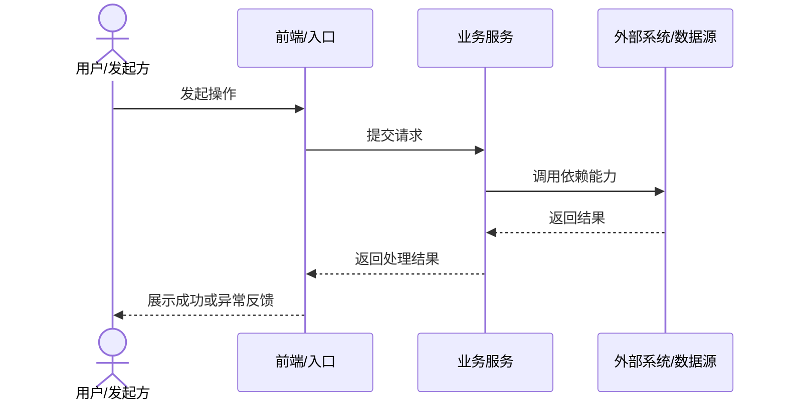

# 产品需求文档（PRD）

> 文档标题建议：`产品/系统名称_功能名称_PRD_V版本号_日期`
>
> 章节标记说明：
> - **[必填]**：所有需求均需说明。
> - **[条件必填]**：涉及该能力时必须说明，不涉及则删除该节。
> - **[可选]**：按需求复杂度决定是否保留。
> - 无法确认的内容统一写入“待确认项”，不得用未经确认的假设补齐。

|  |  |  |  |
| --- | --- | --- | --- |
| **文档信息** |  |  |  |
| 文档版本号 | **V0.1.0** | 编写人 | **【填写】** |
| 文档编号 | **【项目缩写+年月日+自增数字】** | 编写日期 | **YYYY.MM.DD** |
| 产品名称 | **【填写】** | 文档密级 | **公开 / 内部 / 机密 / 待确认** |
| 归属部门/项目 | **【填写】** | 子系统名 | **【填写；无则填“无”】** |
| 文档状态 | **编写中 / 评审中 / 已确认 / 已归档** | 维护状态 | **持续维护中 / 停止维护** |
| **修订信息** |  |  |  |
| 版本号 | 修订人 | 修订日期 | 修订描述 |
| **V0.1.0** | **【填写】** | **YYYY/MM/DD** | 产品初稿 |
| **待办事项** |  |  |  |
| 【填写待补充、待确认或待处理的事项；暂无则填“无”。】 |  |  |  |

## 1. 术语与定义 [必填]

> 专业术语、对象名称和缩写应在正文首次使用前完成定义。没有新增专用术语时，在表格中明确填写“无”。

| 中文术语 | 英文/缩写 | 定义 |
| --- | --- | --- |
| 【填写；无专用术语时填写“无”】 | 【填写】 | 【填写】 |

## 2. 需求概述 [必填]

### 2.1 需求来源

| 需求编号（IR原始需求） | 需求名称 | 需求描述 | 需求链接 | 来源类型 | 提出人 | 提出日期 |
| --- | --- | --- | --- | --- | --- | --- |
| IR-01 | 【填写】 | 【填写】 | 【填写】 | 用户反馈 / 业务需求 / 产品规划 / 线上问题 / 内部需求 / 合规要求 | 【填写】 | YYYY-MM-DD |

### 2.2 需求背景

【说明当前业务流程、系统现状、触发原因和具体问题。只保留与本需求直接相关的背景。】

### 2.3 痛点

| 问题编号（PB） | 问题 | 当前表现 | 影响对象 | 影响程度 | 证据/数据 |
| --- | --- | --- | --- | --- | --- |
| PB-01 | 【填写】 | 【填写】 | 【填写】 | 高 / 中 / 低 | 【填写；没有证据时标注待补充】 |

## 3. 用户、角色与使用场景 [必填]

### 3.1 目标用户

| 用户类型 | 用户特征 | 核心诉求 | 当前做法 | 主要痛点 |
| --- | --- | --- | --- | --- |
| 【填写】 | 【填写】 | 【填写】 | 【填写】 | 【填写】 |

### 3.2 系统角色

| 角色 | 职责 | 可见范围 | 可执行操作 | 数据范围 |
| --- | --- | --- | --- | --- |
| 【填写】 | 【填写】 | 【填写】 | 【填写】 | 【填写】 |

### 3.3 核心用户故事

> 表达格式：作为【角色】，我希望【完成某项任务】，以便【获得结果或价值】。

- 作为【角色】，我希望【能力】，以便【结果】。

### 3.4 核心使用场景

| 场景编号 | 场景名称 | 使用角色 | 触发条件 | 预期结果 | 使用频率 |
| --- | --- | --- | --- | --- | --- |
| S-01 | 【填写】 | 【填写】 | 【填写】 | 【填写】 | 高频 / 中频 / 低频 |

## 4. 需求目标与范围 [必填]

### 4.1 需求目标

| 目标编号 | 目标说明 | 衡量方式 | 目标值 | 验证时间 |
| --- | --- | --- | --- | --- |
| G-01 | 【填写要改善的业务、用户或系统结果】 | 【指标/验收方式】 | 【填写或待确认】 | 【填写】 |

### 4.2 非目标

【明确本需求不试图解决的问题，防止评审和开发过程中不断扩大范围。】

- 本需求不包含：【填写】。

### 4.3 本期范围

| IR原始需求编号 | 范围类型 | 内容 | 说明 |
| --- | --- | --- | --- |
| IR-01 | 本期实现 | 【填写】 | 【填写】 |
| IR-02 | 本期不实现 | 【填写】 | 【原因或后续安排】 |
| IR-03 | 受影响的已有能力 | 【填写】 | 【新增 / 修改 / 下线 / 迁移】 |

### 4.4 后续规划 [可选]

| 事项 | 计划阶段 | 启动条件 | 与本期关系 |
| --- | --- | --- | --- |
| 【填写】 | 下一版本 / 远期 | 【填写】 | 【填写】 |

## 5. 需求方案总览 [必填]

### 5.1 方案说明

【从用户和业务视角描述系统将提供的能力、核心变化和使用方式，不在此处替代技术方案。】

### 5.2 业务流程

【此处必须提供时序图或多角色泳道图，二选一。图示需覆盖参与角色、调用/协作顺序、关键动作、系统反馈、异常分支和终止状态。Markdown 正文必须保留图示本身，优先保留 Mermaid 源码，或使用图片引用；同时另行输出可在浏览器直接打开的 HTML 格式附件，不能只在 Markdown 中保留附件链接。没有具体业务场景时，仅保留图示占位，不得虚构流程。】

### 5.3 需求清单

| SR编号 | 一级模块 | 二级模块 | 需求名称 | 需求说明 | 优先级 | 关联IR需求 | 本期范围 |
| --- | --- | --- | --- | --- | --- | --- | --- |
| SR-01 | 【填写】 | 【填写】 | 【填写】 | 【填写】 | P0 / P1 / P2 | IR-01 | 是 / 否 |

> 优先级建议：P0 为版本不可缺少，P1 为重要但可评估降级，P2 为可延后优化。应结合版本目标排序，避免全部标记为 P0。

## 6. 详细功能需求 [必填]

> 按功能或场景复制“6.x”章节。每项需求应能独立理解、开发和验收。

### 6.1 【场景/功能名称】（SR-01）

#### 6.1.1 需求说明

【说明该功能解决的问题、用户可获得的结果，以及与现有功能相比发生的变化。】

#### 6.1.2 前置条件

- 用户条件：【登录状态、账号状态、角色、权限等】。
- 数据条件：【已有数据、配置状态等】。
- 系统条件：【开关、版本、依赖服务状态等】。

#### 6.1.3 功能入口 [条件必填]

【菜单】→【页面】→【操作入口】

#### 6.1.4 主流程

| 步骤 | 操作主体 | 用户操作/触发事件 | 系统处理 | 页面反馈/输出结果 |
| --- | --- | --- | --- | --- |
| 1 | 【角色/系统】 | 【填写】 | 【填写】 | 【填写】 |

#### 6.1.5 分支与异常流程 [条件必填]

| 编号 | 触发条件 | 系统处理 | 用户提示 | 是否可重试 | 最终状态 |
| --- | --- | --- | --- | --- | --- |
| EX-01 | 【填写】 | 【填写】 | 【准确提示文案或文案原则】 | 是 / 否 | 【填写】 |

#### 6.1.6 业务规则 [必填]

| 规则编号 | 规则名称 | 适用条件 | 规则说明 | 优先级/冲突处理 | 示例 |
| --- | --- | --- | --- | --- | --- |
| BR-01 | 【填写】 | 【填写】 | 【使用明确、可判断的语言】 | 【填写】 | 【填写】 |

#### 6.1.7 页面与交互 [条件必填]

- 原型/设计稿：【链接或待补充】
- 页面状态：默认态 / 加载态 / 空状态 / 成功态 / 失败态 / 无权限态。
- 操作反馈：【按钮状态、二次确认、处理中提示、结果反馈】。
- 跳转与返回：【填写页面跳转、刷新、返回后的状态保留规则】。
- 批量操作：【如涉及，说明选中、全选、部分成功和失败处理】。

#### 6.1.8 字段与校验规则 [条件必填]

| 字段名称 | 字段标识 | 控件/数据类型 | 必填 | 默认值 | 可选值/范围 | 单位/精度 | 校验时机 | 校验与提示 | 展示/编辑权限 | 备注 |
| --- | --- | --- | --- | --- | --- | --- | --- | --- | --- | --- |
| 【填写】 | 【填写】 | 文本 / 数值 / 枚举 / 日期 / 布尔 / 对象 / 其他 | 是 / 否 | 【填写】 | 【填写】 | 【填写】 | 即时 / 失焦 / 提交 | 【填写】 | 【填写】 | 【填写】 |

#### 6.1.9 状态与生命周期 [条件必填]

| 当前状态 | 触发事件 | 条件 | 下一状态 | 可执行角色 | 系统动作 | 是否可撤销 |
| --- | --- | --- | --- | --- | --- | --- |
| 【填写】 | 【填写】 | 【填写】 | 【填写】 | 【填写】 | 【填写】 | 是 / 否 |

#### 6.1.10 权限规则 [条件必填]

| 权限对象 | 操作 | 角色/主体 | 允许条件 | 数据范围 | 无权限表现 | 审计要求 |
| --- | --- | --- | --- | --- | --- | --- |
| 页面 / 菜单 / 按钮 / 字段 / 数据 / API | 查看 / 新增 / 编辑 / 删除 / 导出 / 执行 | 【填写】 | 【填写】 | 本人 / 组织 / 项目 / 全部 / 自定义 | 隐藏 / 禁用 / 提示 | 【填写】 |

#### 6.1.11 通知与消息 [条件必填]

| 触发事件 | 接收人 | 渠道 | 发送时机 | 消息内容 | 去重/频控 | 跳转目标 |
| --- | --- | --- | --- | --- | --- | --- |
| 【填写】 | 【填写】 | 站内 / App / 邮件 / 短信 / IM | 即时 / 定时 | 【填写或引用文案】 | 【填写】 | 【填写】 |

#### 6.1.12 操作日志与审计 [条件必填]

| 操作 | 记录内容 | 查询角色 | 保留期限 | 脱敏要求 | 备注 |
| --- | --- | --- | --- | --- | --- |
| 【填写】 | 操作人、时间、对象、操作前后值、结果、失败原因等 | 【填写】 | 【填写】 | 【填写】 | 【填写】 |

#### 6.1.13 功能验收标准 [可选]

| 验收编号 | 前提 | 操作/事件 | 预期结果 | 关联规则 | 优先级 |
| --- | --- | --- | --- | --- | --- |
| AC-01 | Given【前置条件】 | When【执行动作】 | Then【可观察结果】 | BR-01 | P0 |

## 7. 数据与系统协作 [条件必填]

### 7.1 数据说明

| 数据对象 | 数据来源 | 关键字段 | 新增/变更 | 更新频率 | 数据责任方 | 质量要求 |
| --- | --- | --- | --- | --- | --- | --- |
| 【填写】 | 【填写】 | 【填写】 | 【填写】 | 实时 / 定时 / 手动 | 【填写】 | 完整性、准确性、及时性要求 |

### 7.2 历史数据与数据迁移

- 是否处理历史数据：是 / 否。
- 处理范围：【填写】。
- 清洗、补录、转换和去重规则：【填写】。
- 失败回退与核对方式：【填写】。

### 7.3 外部系统与接口依赖

| 依赖系统/API | 依赖能力 | 调用方向 | 输入/输出概要 | 超时/失败处理 | 责任方 | 联调状态 |
| --- | --- | --- | --- | --- | --- | --- |
| 【填写】 | 【填写】 | 调入 / 调出 / 双向 | 【填写或引用接口文档】 | 【填写】 | 【填写】 | 未开始 / 进行中 / 已完成 |

> PRD 说明产品需要的输入、输出、时效和异常表现；详细协议、表结构和技术实现放入对应技术设计文档，除非它们本身就是必须冻结的产品契约。

### 7.4 数据埋点与效果监测 [条件必填]

| 事件名称 | 触发时机 | 关键属性 | 统计口径 | 对应指标 | 备注 |
| --- | --- | --- | --- | --- | --- |
| 【填写】 | 【填写】 | 【填写】 | 【填写】 | 【填写】 | 【填写】 |

## 8. 非功能要求 [条件必填]

| 类型 | 要求 | 指标/边界 | 验证方式 | 优先级 |
| --- | --- | --- | --- | --- |
| 性能 | 【响应时间、并发量、吞吐量等】 | 【填写】 | 【填写】 | P0 / P1 / P2 |
| 可用性 | 【服务可用率、降级策略等】 | 【填写】 | 【填写】 | 【填写】 |
| 安全 | 【认证、防越权、防重放、敏感操作确认等】 | 【填写】 | 【填写】 | 【填写】 |
| 隐私与合规 | 【采集、使用、存储、脱敏、删除要求】 | 【填写】 | 【填写】 | 【填写】 |
| 兼容性 | 【浏览器、系统、设备、版本等】 | 【填写】 | 【填写】 | 【填写】 |
| 可访问性 | 【键盘、对比度、读屏等】 | 【填写】 | 【填写】 | 【填写】 |
| 可维护性 | 【配置化、日志、监控、告警等产品要求】 | 【填写】 | 【填写】 | 【填写】 |

## 9. 发布与上线 [必填]

### 9.1 版本拆分

| 版本/阶段 | 包含需求 | 不包含内容 | 发布条件 |
| --- | --- | --- | --- |
| MVP / V1 | 【填写】 | 【填写】 | 【填写】 |

### 9.2 上线准备

| 准备事项 | 负责人 | 完成标准 | 截止时间 | 状态 |
| --- | --- | --- | --- | --- |
| 产品配置 / 数据准备 / 权限配置 / 培训 / 客服口径 / 运营通知 / 监控告警 | 【填写】 | 【填写】 | YYYY-MM-DD | 未开始 / 进行中 / 已完成 |

### 9.3 灰度与开关 [条件必填]

- 灰度对象和范围：【填写】。
- 放量节奏及观察指标：【填写】。
- 功能开关、配置入口及管理权限：【填写】。
- 暂停放量条件：【填写】。

### 9.4 回滚与应急 [条件必填]

- 回滚触发条件：【填写】。
- 回滚范围与方式：【填写】。
- 数据恢复或补偿方式：【填写】。
- 应急联系人与响应机制：【填写】。

## 10. 验收计划 [必填]

### 10.1 验收范围

【说明参与验收的功能、角色、环境、数据和不纳入本次验收的内容。】

### 10.2 验收条件

- 所有 P0 需求已完成且不存在阻断问题。
- 核心主流程及关键异常流程验证通过。
- 权限、数据范围和敏感操作验证通过。
- 相关监控、日志、埋点或报表可用。
- 【按项目补充其他上线门槛】。

### 10.3 需求追踪

| SR编号 | 原型/设计 | 开发任务 | 测试用例 | 验收结果 | 遗留问题 |
| --- | --- | --- | --- | --- | --- |
| SR-01 | 【链接】 | 【链接】 | 【链接】 | 通过 / 不通过 / 有条件通过 | 【填写】 |

## 11. 风险、依赖与待确认项 [必填]

### 11.1 风险清单

| 风险编号 | 风险说明 | 发生概率 | 影响程度 | 应对措施 | 负责人 | 状态 |
| --- | --- | --- | --- | --- | --- | --- |
| R-01 | 【填写】 | 高 / 中 / 低 | 高 / 中 / 低 | 规避 / 降低 / 转移 / 接受及具体措施 | 【填写】 | 跟踪中 / 已关闭 |

### 11.2 外部依赖

| 依赖事项 | 依赖方 | 期望交付 | 最晚时间 | 未完成影响 | 备选方案 |
| --- | --- | --- | --- | --- | --- |
| 【填写】 | 【填写】 | 【填写】 | YYYY-MM-DD | 【填写】 | 【填写】 |

### 11.3 假设

| 假设 | 判断依据 | 验证方式 | 验证人 | 验证时间 | 验证结果 |
| --- | --- | --- | --- | --- | --- |
| 【填写】 | 【填写】 | 【填写】 | 【填写】 | YYYY-MM-DD | 待验证 / 成立 / 不成立 |

### 11.4 待确认项

| 编号 | 待确认问题 | 影响范围 | 决策人 | 计划确认时间 | 当前结论 |
| --- | --- | --- | --- | --- | --- |
| Q-01 | 【填写】 | 【填写】 | 【填写】 | YYYY-MM-DD | 待确认 |

## 12. 决策记录 [可选]

| 决策编号 | 决策事项 | 可选方案 | 最终结论 | 决策依据 | 决策人 | 日期 |
| --- | --- | --- | --- | --- | --- | --- |
| D-01 | 【填写】 | 【填写】 | 【填写】 | 【填写】 | 【填写】 | YYYY-MM-DD |

## 13. 附录 [可选]

### 13.1 相关资料

| 资料名称 | 链接/路径 | 版本/日期 | 说明 |
| --- | --- | --- | --- |
| 原始需求 | 【填写】 | 【填写】 | 【填写】 |
| 原型/设计稿 | 【填写】 | 【填写】 | 【填写】 |
| 接口文档 | 【填写】 | 【填写】 | 【填写】 |
| 数据口径 | 【填写】 | 【填写】 | 【填写】 |
| 技术方案 | 【填写】 | 【填写】 | 【填写】 |
| 测试方案 | 【填写】 | 【填写】 | 【填写】 |

### 13.2 补充说明

【填写无法归入正文、但有助于理解或追溯需求的信息。】

---

## 提交评审前自检清单

- [ ] 背景描述了真实现状和具体问题，而不是只写结论。
- [ ] 目标、非目标、本期范围和本期不做的内容清晰。
- [ ] 每个需求都有唯一的 IPD 编号（RR/PB/SF/IR/SR/AR）、明确优先级和对应场景。
- [ ] 主流程、分支、异常和边界条件完整。
- [ ] 业务规则使用可判断、无歧义的语言。
- [ ] 字段、默认值、范围、精度、校验和错误提示可执行。
- [ ] 角色、功能权限和数据权限有明确边界。
- [ ] 涉及状态变化时，状态、事件和操作权限可闭环。
- [ ] 涉及写操作时，确认、幂等、失败补偿和审计要求已说明。
- [ ] 数据来源、历史数据、外部接口和责任方已明确。
- [ ] 非功能要求包含可验证的指标，而不是“性能良好”等模糊表达。
- [ ] 验收标准可观察、可测试，并与需求编号对应。
- [ ] 发布、灰度、回滚及上线协作要求已明确。
- [ ] 所有未知信息均列入待确认项，没有被写成确定事实。
- [ ] 正文只保留适用于本需求的章节，无关占位章节已删除。
